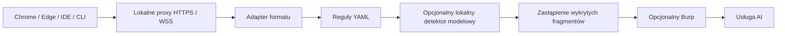

# Anonimo

Prototyp lokalnej warstwy DLP dla czatów internetowych i klientów AI. Użytkownik pisze wiadomość i klika **Wyślij**. Lokalny proces przechwytuje ruch, wykrywa wybrane dane i przekazuje oczyszczony tekst do usługi AI.

**Stan: działający prototyp transportu i reguł, nie gotowy produkt korporacyjny.** Własny model nie jest jeszcze wytrenowany ani dołączony. Domyślnie działa tryb `rules_only`, który nie wykryje wszystkich nazw osób, firm ani tajemnic przedsiębiorstwa. Zgodność z zalogowanymi aplikacjami i klientami należy potwierdzić w pilotażu.

## Przepływ



Obie ścieżki detekcji działają lokalnie. Znalezione fragmenty otrzymują znaczniki typu `[EMAIL_1]`, `[TAX_ID_1]`, `[PERSON_1]`. Powtórzenia tej samej wartości w jednym żądaniu mają wspólny znacznik. Mapowanie istnieje wyłącznie w pamięci podczas analizy; nie jest zwracane ani zapisywane. To pseudonimizacja wykrytych fragmentów, bez gwarancji pełnej anonimizacji i bez automatycznego odtwarzania danych w odpowiedzi modelu.

## Zakres pierwszej wersji

- YAML: e-maile, wybrane klucze API, przypisania sekretów, tokeny Bearer, klucze prywatne, PESEL, NIP, polskie rachunki bankowe, wybrane formaty telefonów, prywatne IPv4 i kod w blokach Markdown. PESEL, NIP i rachunki mają walidację sum kontrolnych. Lista nie obejmuje wszystkich istniejących formatów.
- Własne reguły literalne/regex oraz akcje `replace` i `block`. Limity czasu regex, długości treści i współbieżności.
- Adaptery tekstowych żądań WWW ChatGPT/Claude oraz jednego formatu Gemini. Ogólny adapter JSON dla nowych endpointów i domen zapisanych w YAML.
- Transport JSON API dla OpenAI Responses/Chat Completions, Anthropic Messages, Gemini API i GitHub Copilot. Pozwala filtrować ruch klientów takich jak Codex i Claude Code, jeżeli dany klient używa skonfigurowanego proxy i ufa lokalnemu CA.
- Wiadomości wychodzące WebSocket: JSON i JSON z separatorami SignalR. To podstawa integracji z Microsoft Copilot, nie potwierdzenie zgodności ze wszystkimi wersjami tego produktu.
- Lokalny adapter detektora zgodnego z OpenAI `/v1/chat/completions`. Wymusza adres loopback, waliduje wskazane fragmenty i blokuje żądanie przy awarii lub nieprawidłowej odpowiedzi modelu. Nie stosuje zewnętrznego fallbacku.
- Usługa API do późniejszego użycia np. przy pisaniu maili; proxy HTTPS/WSS jako główne wejście; skrypty instalacji w tle dla Windows.

Formaty serwisów WWW są niepubliczne i mogą się zmieniać. Testy w repozytorium używają syntetycznych żądań i lokalnego odbiorcy. Nie wykonano testów na kontach ChatGPT, Claude, Gemini, Copilot, Codex ani Claude Code.

## Szybki start deweloperski

Wymagania: Python 3.12+ oraz [uv](https://docs.astral.sh/uv/getting-started/installation/).

```sh
uv sync --locked --extra proxy
uv run --frozen --extra proxy anonimo check-policy
uv run --frozen --extra proxy pytest -q
uv run --frozen --extra proxy python scripts/smoke_proxy.py
uv run --frozen --extra proxy python scripts/smoke_websocket.py
uv run --frozen --extra proxy python scripts/benchmark.py
```

Uruchomienie API i proxy w jednym procesie:

```sh
uv run --frozen --extra proxy anonimo background
```

API nasłuchuje na `127.0.0.1:8765`, proxy na `127.0.0.1:8877`. Token API powstaje w `.local/token`, a unikalny lokalny CA w `.local/proxy`. Proces nie zmienia sam ustawień systemowych i nie instaluje certyfikatów. Test funkcjonalny API z drugiego terminala:

```sh
uv run --frozen --extra proxy python scripts/smoke_api.py
```

Bez proxy można zainstalować sam rdzeń (`uv sync --locked`) i uruchomić `anonimo serve`. Endpointy `POST /v1/sanitize-text` i `POST /v1/sanitize-request` wymagają nagłówka `Authorization: Bearer <lokalny token>`. Tokenów i treści użytkownika nie należy umieszczać w logach ani repozytorium.

## Windows, Burp i klienci

- [Instalacja w tle, autostart i usuwanie ustawień](docs/windows.md)
- [Burp, IDE, Codex, Claude Code i Copilot](docs/integrations.md)
- [Model, wydajność i ocena skuteczności](docs/model-and-evaluation.md)
- [Granice prototypu i dalsza architektura](docs/architecture.md)

Skrypty Windows są przygotowane do pilotażu, lecz nie zostały uruchomione w tym linuksowym środowisku. W firmie konfigurację certyfikatów, proxy i autostartu powinno wdrażać IT zgodnie z istniejącymi ustawieniami.

## Ważne granice

Analizowane są wartości tekstowe w treści żądań do skonfigurowanych domen. Nie są analizowane nagłówki, cookies, parametry URL, nazwy kluczy JSON, odpowiedzi serwera ani ruch omijający proxy. Wartości zakodowane np. w base64 nie są ogólnie dekodowane. Znane załączniki są blokowane; nie ma OCR ani anonimizacji PDF/obrazów. Nieznane protokoły/binarne treści do chronionych domen są blokowane i mogą zakłócić działanie aplikacji. WebSockety o nieobsługiwanym formacie tracą wiadomość bez gwarancji czytelnego komunikatu w interfejsie strony.

Instalacja nie wdraża sterownika EDR, nie zapobiega obchodzeniu proxy i nie zarządza politykami przeglądarek. Silnik ogranicza przypadkowe ujawnienie danych; brak detekcji nie oznacza, że tekst jest bezpieczny. Domyślna reguła kodu usuwa całe bloki Markdown — dla asystentów programistycznych należy świadomie dopasować politykę, aby zachować użyteczność.
